# HW2 — 多元線性回歸預測各國平均壽命（CRISP-DM）

> 以 Kaggle **WHO Life Expectancy** 資料集（20 個特徵）建立多元線性回歸模型，完整走過 CRISP-DM 六個階段，
> 包含 5 種特徵選擇方法比較、以「未見過的國家」做模型評估，以及附 **信賴區間 (CI) / 預測區間 (PI)** 的預測圖。

| 項目 | 連結 |
|---|---|
| 🌐 Web Demo (Streamlit) | `https://<your-app>.streamlit.app`（部署後填入） |
| 💻 GitHub | `https://github.com/<your-account>/<repo>` |
| 📊 資料集來源 | [Kaggle — Life Expectancy (WHO), by KumarRajarshi](https://www.kaggle.com/datasets/kumarajarshi/life-expectancy-who) |

---

## 專案結構

```
HW2/
├── app.py                 # Streamlit 互動網頁（CRISP-DM 六個分頁 + What-if 預測器）
├── analysis.py            # 離線分析：產生 figures/ 與 results/
├── src/pipeline.py        # 共用流程：清理、切分、特徵選擇、OLS、CI/PI
├── data/Life Expectancy Data.csv
├── figures/               # 11 張分析圖
├── results/               # 指標、OLS summary、特徵選擇比較表、測試集預測
├── ai/                    # GPT 對話 PDF、NotebookLM 摘要（optional 繳交）
└── requirements.txt
```

執行方式：

```bash
pip install -r requirements.txt
python analysis.py          # 重新產生所有圖表與結果
streamlit run app.py        # 開啟網頁
```

---

## 1. Business Understanding（商業理解）

- **問題**：平均壽命是衡量國家衛生體系的關鍵指標。衛生部門與 NGO 想知道「哪些可量測的因素」（死亡率、疫苗接種率、所得、教育、HIV 盛行率…）與平均壽命相關，並能依一國的指標估計其預期壽命。
- **目標**：建立可解釋的 **多元線性回歸** 模型，(1) 預測平均壽命（年）、(2) 透過特徵選擇找出關鍵因子、(3) 以 CI / PI 量化不確定性。
- **成功標準**：在「訓練時從未見過的國家」上，Test R² ≥ 0.80、RMSE ≤ 4 年，且 95% PI 涵蓋率接近 95%。

## 2. Data Understanding（資料理解）

- 資料：193 國 × 2000–2015 年，共 **2,938 筆、22 欄**（目標 `Life expectancy` + Country + 20 個特徵）。
- 特徵類型：死亡率（Adult Mortality、infant / under-five deaths、HIV/AIDS）、疫苗（Hepatitis B、Polio、Diphtheria）、經濟（GDP、percentage / total expenditure、Income composition）、社會（Schooling、BMI、thinness、Alcohol）、Population、Status（開發中/已開發）、Year。
- 缺值集中在 Population (652)、Hepatitis B (553)、GDP (448)、Total expenditure (226)…

| 缺值分布 | 目標變數分布 |
|---|---|
| 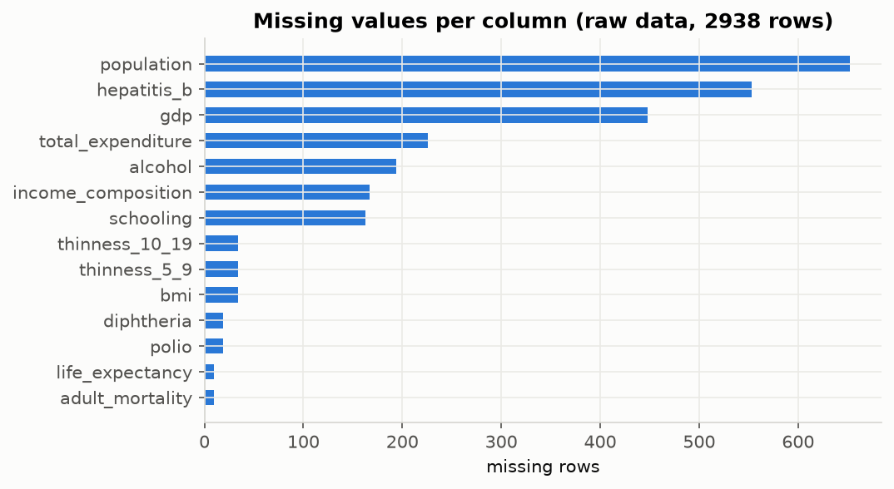 | 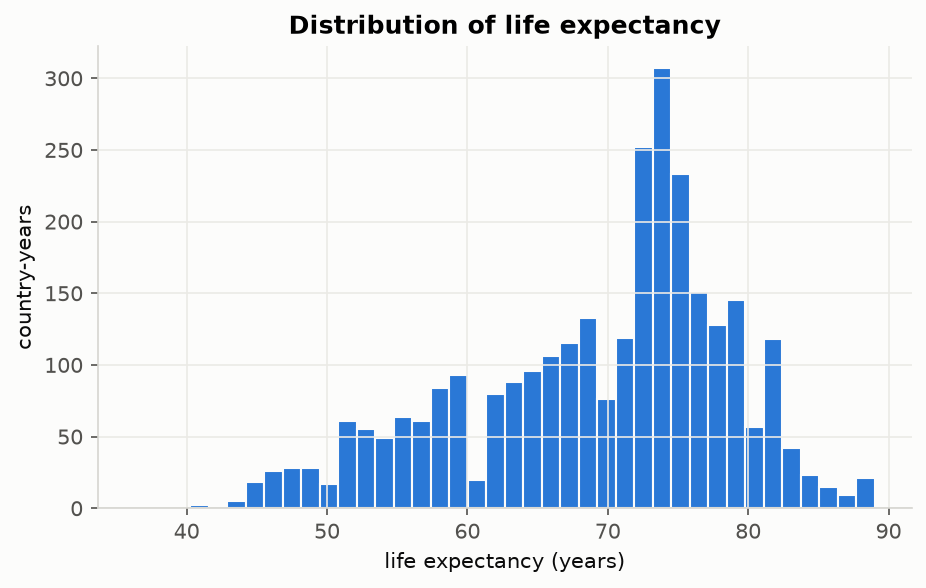 |

| 與目標的相關係數 | 相關係數矩陣 |
|---|---|
| 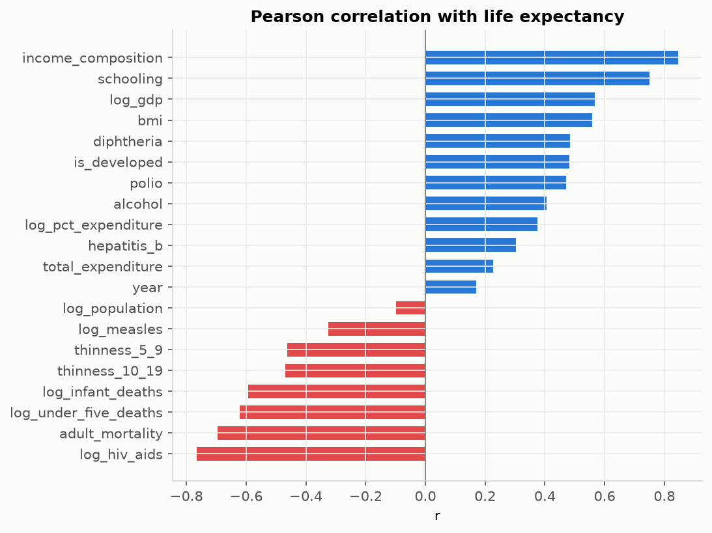 | 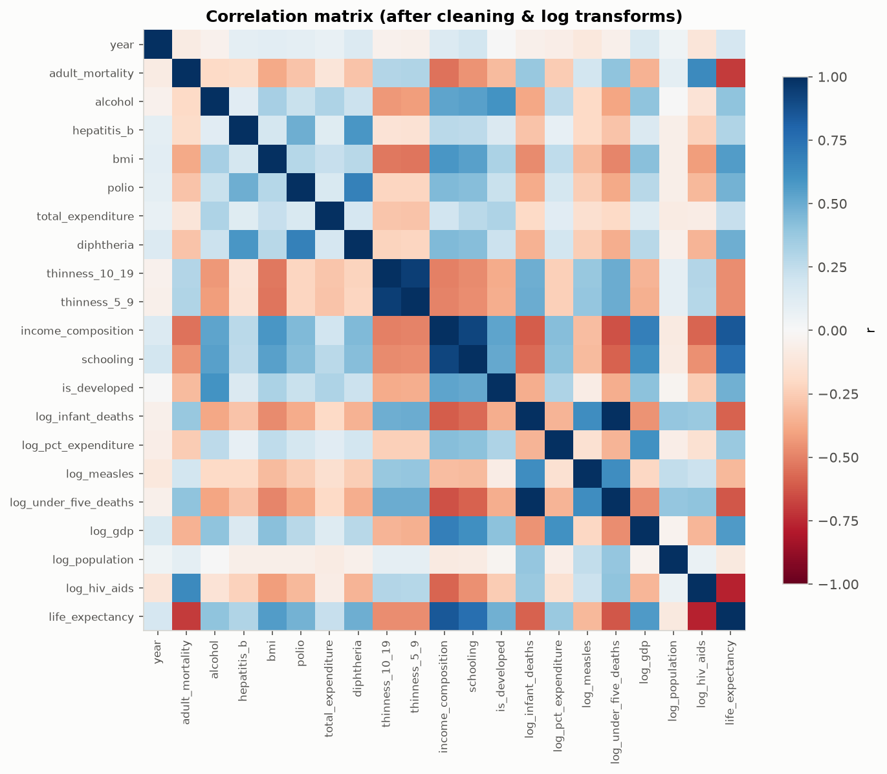 |

觀察：`Schooling`、`Income composition`、`Adult Mortality`、`log HIV/AIDS` 與壽命高度相關；`infant deaths` 與 `under-five deaths`、兩個 `thinness` 欄位彼此高度共線。

## 3. Data Preparation（資料準備）

1. **欄名清理**：Kaggle 欄名含多餘空白（如 `"Life expectancy "`），統一 strip 並改為 snake_case。
2. **目標缺值**：刪除 10 筆無 `Life expectancy` 的資料 → 2,928 筆。
3. **不合理的 0**：`BMI`、`Income composition`、`Schooling` 為 0 視為登錄錯誤 → 設為缺值。
4. **補值**：先用「同一國家」的中位數補（國家指標隨時間穩定），再用全體中位數補。
5. **編碼**：`Status` → `is_developed`（0/1）；`Country` 僅作為分組鍵，不當特徵。
6. **轉換**：對右偏嚴重的 `infant_deaths, pct_expenditure, measles, under_five_deaths, gdp, population, hiv_aids` 取 `log1p`，讓關係更接近線性。
7. **切分**：`GroupShuffleSplit` 依 **國家** 80/20 切分 → 146 個訓練國 (2,336 筆) / 37 個測試國 (592 筆)。
   若隨機以「列」切分，同一國家不同年份會同時出現在訓練與測試集，造成資料洩漏、分數虛高。

## 4. Modeling（建模）— 特徵選擇 + OLS

在 **訓練集** 上比較 5 種特徵選擇策略，以 5-fold **依國家分組** 的交叉驗證 RMSE 作為選模依據（測試集只用於最終評估）：

| 方法 | 特徵數 | CV RMSE | Test R² | Test RMSE |
|---|---:|---:|---:|---:|
| All features | 20 | 3.706 | 0.873 | 3.438 |
| SelectKBest (F-test, k=8) | 8 | 3.692 | 0.849 | 3.752 |
| **RFECV（選用）** | **6** | **3.599** | **0.853** | **3.710** |
| Lasso (L1) | 11 | 3.655 | 0.875 | 3.415 |
| VIF<10 + Backward (p<0.05) | 10 | 3.883 | 0.860 | 3.616 |

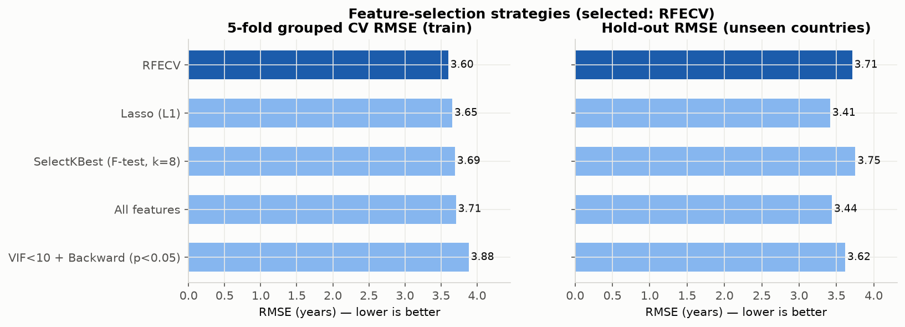

**最終模型（RFECV，6 個特徵）**：`adult_mortality, diphtheria, income_composition, log_infant_deaths, log_under_five_deaths, log_hiv_aids`，以 statsmodels OLS 擬合（完整 summary 見 [`results/ols_summary.txt`](results/ols_summary.txt)）。

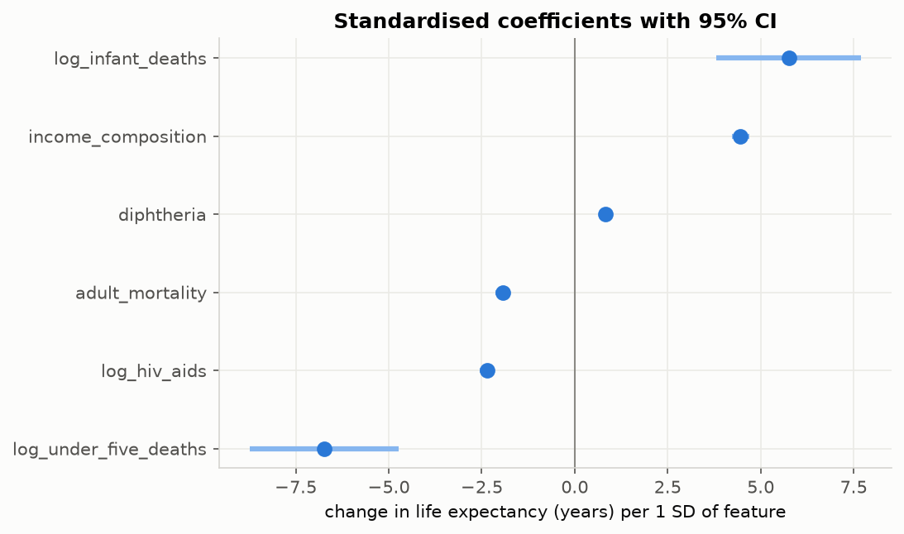

解讀（每增加 1 個標準差）：所得組成指數（HDI 的所得面向）是最強的正向因子（約 +4.5 年），白喉疫苗接種率也是正向（約 +0.8 年）；HIV/AIDS（約 −2.3 年）與成人死亡率（約 −1.9 年）為負向。
`log_infant_deaths`（+5.8）與 `log_under_five_deaths`（−6.7）共線性極高（VIF ≈ 190–200），單獨看兩者係數都很大且方向相反、CI 很寬，必須合併解讀：兩者一起增加時，淨效果約 −1 年。共線性不影響預測，但會讓單一係數難以解釋。若重視可解釋性，可改用只保留其中一個的「VIF<10 + Backward」模型（Test R² 0.860）。

## 5. Evaluation（評估）

| 指標 | Train | **Test（未見過的 37 國）** |
|---|---:|---:|
| R² | 0.863 | **0.853** |
| RMSE (年) | 3.49 | **3.71** |
| MAE (年) | 2.58 | **2.86** |
| 95% PI 涵蓋率 | — | **92.6%** |

### 預測圖（含 95% 信賴區間與預測區間）

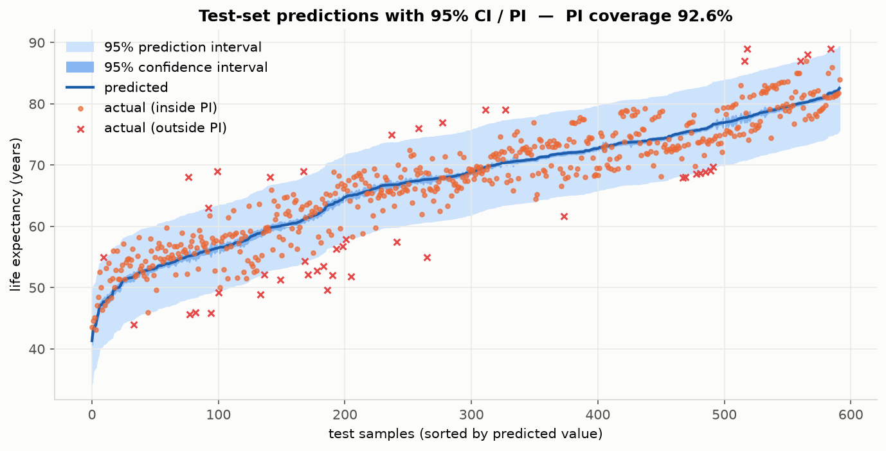

- 深藍帶 = **信賴區間 (CI)**：「平均」壽命的不確定性，很窄。
- 淺藍帶 = **預測區間 (PI)**：「單一國家-年份」的不確定性，約 ±7 年；92.6% 的實際值落在 95% PI 內，接近名目水準。

| 實際 vs 預測（誤差棒 = PI） | 殘差診斷 |
|---|---|
| 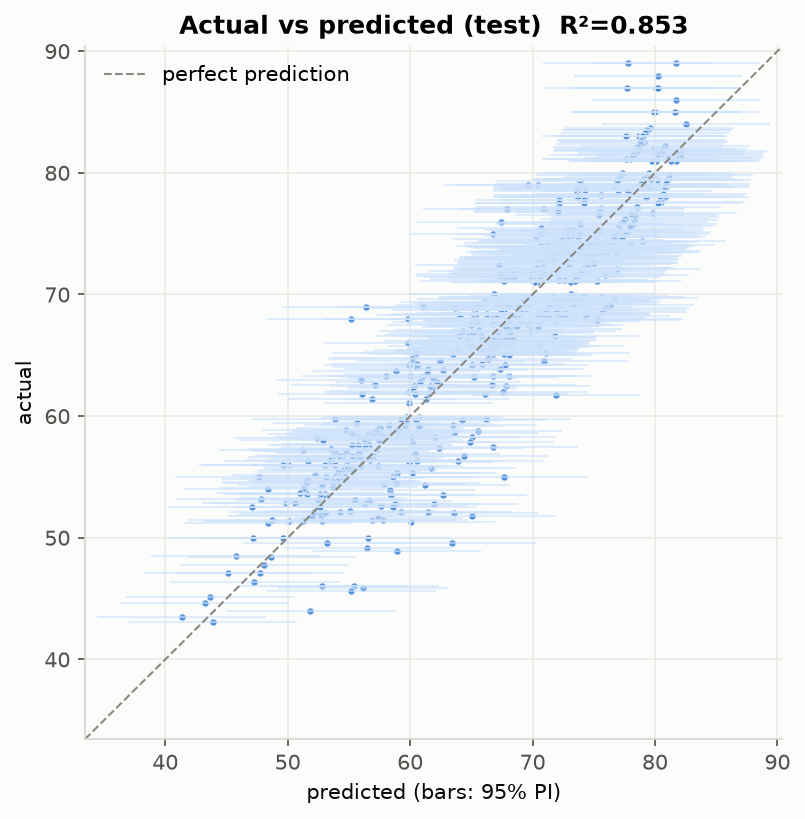 | 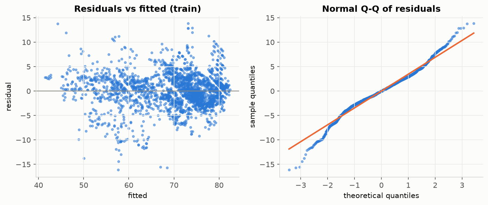 |

| 單純線性回歸（對照組，僅 income_composition，Test R²=0.658） | 測試國家逐年預測 |
|---|---|
| 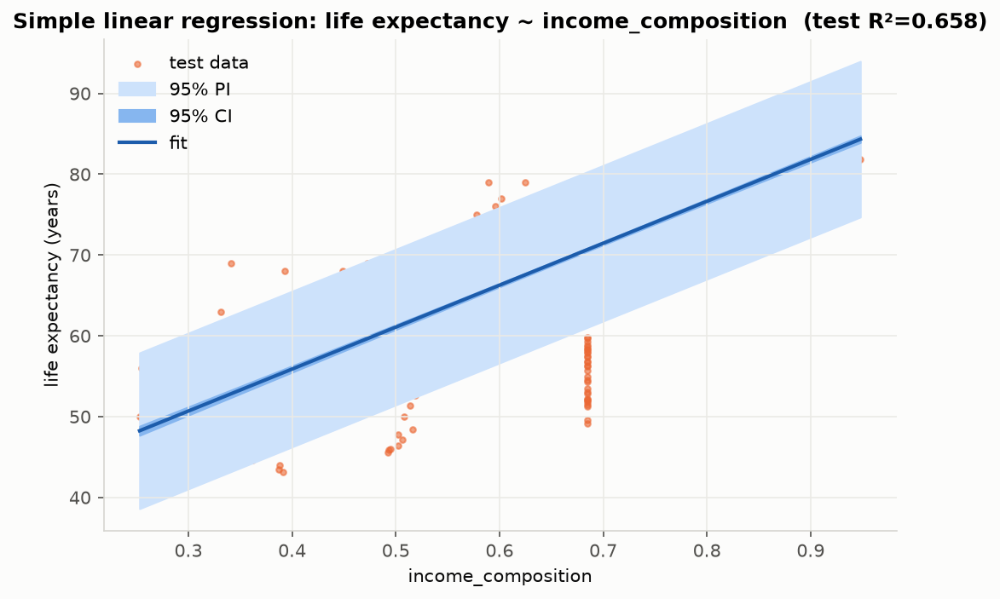 | 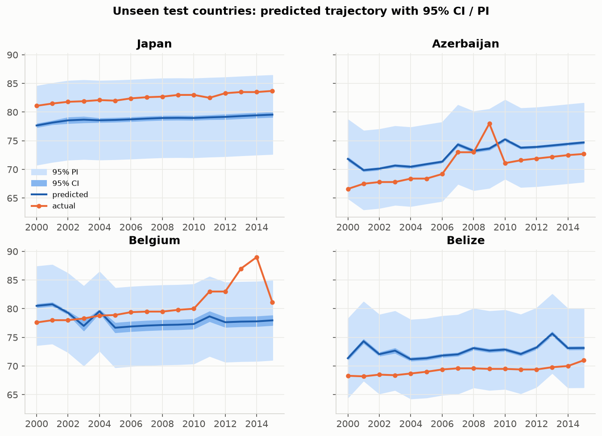 |

**結論**：多元回歸（Test R² 0.853）明顯優於單純線性回歸（0.658），達成 R² ≥ 0.80、RMSE ≤ 4 年的商業目標。
限制：殘差在低壽命區略有異質變異、Q-Q 圖尾端偏離常態，所以 PI 在極端值上略為不足；資料本身有錄入錯誤（如部分國家 population 量級跳動）。
Lasso / 全部特徵在測試集 RMSE 更低（3.4），但 RFECV 只用 6 個特徵、CV 最佳，較精簡易解釋。

## 6. Deployment（部署）

- **Web App**：`app.py` 以 Streamlit 製作，分為 CRISP-DM 六個分頁。側邊欄可切換特徵選擇方法、手動挑選特徵、調整區間信心水準；
  「Deployment / Predict」分頁提供 What-if 預測器，輸入指標即輸出預測值 + CI + PI。
- **部署步驟**：push 到 GitHub → [Streamlit Community Cloud](https://share.streamlit.io) → New app → 選 repo、`app.py` → Deploy。
- **維運**：WHO 每年更新資料時重新訓練；監控資料漂移（例如 2020 年後 COVID-19 衝擊不在訓練範圍內）。

---

## 🤖 GPT 輔助內容

本作業使用生成式 AI 協助，以下標示 AI 參與部分（對話紀錄 PDF 置於 [`ai/`](ai/)）：

| 部分 | AI 協助內容 | 本人工作 |
|---|---|---|
| 資料集選擇 | 建議符合「>13 特徵」且適合線性回歸的 Kaggle 資料集 | 確認資料來源與授權 |
| 資料準備 | 建議依國家分組補值、對偏態欄位取 log、以國家分組切分避免資料洩漏 | 檢查缺值與異常值 |
| 程式碼 | 協助撰寫 `src/pipeline.py`、`analysis.py`、`app.py` | 執行、檢查結果與圖表 |
| 報告 | 協助撰寫 README 的 CRISP-DM 說明與結果解讀 | 審閱與修改 |


---

## 參考資料

- KumarRajarshi, *Life Expectancy (WHO)*, Kaggle. https://www.kaggle.com/datasets/kumarajarshi/life-expectancy-who
- Seabold & Perktold, *statsmodels*；Pedregosa et al., *scikit-learn*；Streamlit。
